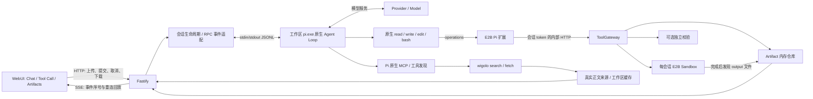

# Spawn Pi Agent 设计架构文档

版本：1.0；日期：2026-10-22；对应当前实现。项目定位为面试笔试的最小可扩展 Coding Agent 及其测试支撑系统。题目的测试与质量评估约占70%，因此用可追溯的真实执行和故障测试证明核心能力，保留未覆盖范围。

## 1. 目标与边界

以用户指定的 TypeScript/Fastify、工作区 pi.exe RPC、E2B 为基础。Pi 提供原生 Agent Loop、模型适配、工具选择、代码生成、上下文、重试机制及 MCP；二开只实现 Web 接入、远程工具 operations、事件映射、校验和 Artifact 交付。

示例二及追问是核心验收。通过相同入口支持其他编程和数据处理任务，不从用户措辞选择预置排序脚本。服务没有额外实现 ReAct 循环或模型 API Client。已通过Pi原生MCP接入wigolo搜索和正文获取；来源选择由Pi执行，服务保留真实来源证据。示例一和持久化未纳入本轮完成声明。

## 2. 总体结构

Fastify 和 Pi 位于本机可信应用进程；用户数据和模型生成的 Shell/Python 位于 E2B。模型服务通过 Pi 调用。工具扩展使用 Pi 二进制提供的 SDK 模块加载，不额外安装另一套 Agent SDK。

## 3. 模块职责

| 模块 | 责任 | 明确边界 |
|---|---|---|
| public/index.html | 双面板、自动上传、流式文字、工具轨迹、取消、预览和下载 | 不执行分析代码，不生成业务答案 |
| src/server.ts | HTTP/SSE、会话隔离、文件上传、内部桥鉴权、完成前交付、关闭回收 | 不解析用户任务意图 |
| src/agent/rpc-client.ts | 启动/保留 Pi 子进程、JSONL 分帧、UTF8、request ID、超时和进程退出 | 不生成代码或决定下一步工具 |
| src/agent/runner.ts | 传递原始请求及附件元数据、订阅原生事件、等待 agent_settled、状态收敛 | 类名保留 AgentOrchestrator，但职责只是运行适配器 |
| .pi/extensions/e2b.mjs | 注册 Pi 原生工具的远程 operations、工作环境提示、publish_artifact | 工具内部读写和 bash 全部去 E2B |
| src/sandbox/gateway.ts | 参数约束、桥操作、可选校验、注册文件 | 不路由任务、不执行宿主机命令 |
| src/sandbox/provider.ts | E2B 生命周期、字节读写、命令句柄/超时/取消 | Memory 实现只存文件，exec 必须抛错 |
| src/sandbox/validators.ts | 整数排序、7倍数的独立金标检查 | 是可选验证器，不限制 Agent 可做的任务 |
| src/artifacts/store.ts | 保存 bytes、MIME、路径、大小、SHA256与归属 | 内存保存，未接 R2 |
| src/web/、scripts/mcp/wigolo.ts | 工作区环境、上游服务启动、成功正文的来源提取 | 不实现另一个Agent或MCP Client |
| tests/、scripts/ | 协议回放、故障注入、真实 HTTP/模型/E2B/浏览器验证 | 各环境分别报告 |

## 4. RPC 进程与配置

每个应用 session 对应一个 Pi 进程和一个 E2B Sandbox。Pi 首次提问时懒启动，此后同会话复用该进程，原生对话上下文自然延续；附件、脚本和中间数据保留在同一 E2B 中。应用不重复实现历史消息拼接和短期记忆。

启动参数的目的：

- `--mode rpc --no-session`：JSONL RPC，保留进程内上下文，关闭磁盘会话持久化。
- `--offline --no-context-files --no-extensions`：关闭启动更新检查、宿主上下文文件加载及自动发现扩展；offline 不阻止模型/E2B请求。
- 显式 `-e e2b.mjs`、`-e builtin:codemode`、`-e builtin:tool-search`、`-e builtin:mcp`：只加载本项目需要的扩展。
- `--no-builtin-tools`：关闭原生宿主机工具，保留扩展注册的远程工具。
- `--provider`、`--model`：从工作区 .env 选择模型。

进程 cwd 为 `.pi/runtime/<sessionId>`，`PI_CODING_AGENT_DIR` 指向工作区 `.pi/agent`。RPC 启动以 get_state 检查通信，再以 get_commands 中 sandbox-status 检查扩展已加载。JSONL 使用 StringDecoder 跨 chunk 解码中文；响应按 id 匹配请求，模型/工具事件独立分发。

`prompt` 的 success 只是请求接受。收到 `agent_end` 时可能还有自动重试；应用以 `agent_settled` 为终态。中途工具错误转发给界面且允许 Pi 自行修复，最终模型错误/进程退出/运行超时转为 run_failed，不伪造成功回答。

## 5. 工具远程适配

扩展直接调用 Pi SDK 的 createReadTool/createWriteTool/createEditTool/createBashTool，以 operations 注入远程文件和命令行为。这样保留 Pi 原生工具格式、编辑匹配与差异处理，由 Pi 自主选择调用顺序。

Windows 文件工具使用会话 cwd 解析相对路径，扩展再映射到 Linux /workspace。允许 input/data.csv、work/analyze.py、output/result.csv；宿主绝对路径、路径逃逸在扩展/网关处拒绝。Shell 是任意沙箱命令，路径限制不把 E2B 内完整操作系统误称为只读 /workspace；真正宿主隔离来自 E2B。

内部桥使用每会话随机 token、timingSafeEqual、active-run 检查。token 保留在进程环境和服务内存，不返回浏览器状态。支持 read/stat/write/mkdir/exec/publish，Zod 校验操作参数；read/write 使用 base64 保存原字节。E2B 上传复制 Uint8Array 有效区间，避免 Node Buffer 共享底层内存导致额外数据上传。

bash 超时默认120秒、桥允许最大300秒；E2B background command handle 等待执行结果，取消时 kill；非零退出保留 stdout/stderr/exitCode 给 Pi。工具输出按完成事件返回；当前没有逐字节转发 E2B 命令的实时 stdout，不能把 SSE 文本流等同于 Shell 实时流。

## 6. 文件交付和校验

用户文件上传至 /workspace/input；Pi 生成代码在 /workspace/work，用户结果写 /workspace/output。主要交付路径是 publish_artifact；同时完成前扫描 output 中的新文件或内容变化，补交模型遗漏发布的文件，防止“任务已完成但无下载卡片”。

publish 支持三类校验：

| 类型 | 证明内容 |
|---|---|
| file | 文件可读、大小、SHA256。不能证明计算语义正确 |
| integer-sort | 输入输出可解析、非递减、数量和多重集合一致，摘要和哈希 |
| multiples-of-7 | 与输入中所有7倍数的降序金标逐项一致 |

有重复数字时采用非递减/非递增，与保留重复次数要求一致。若独立语义校验失败，相同路径、相同哈希不能通过改选 file 绕过；必须修复内容。泛化任务由模型编写适合的断言，并在测试脚本中以独立固定金标再次核对。

Artifact 元数据包含 artifactId、sessionId、沙箱路径、filename、contentType、size、sha256、createdAt。内容复制进服务内存，由下载接口传递；PNG/JPEG等通过正确 MIME 预览，文本使用 textContent，避免把生成内容当 HTML 执行。同路径同哈希去重，变化内容产生新版本。

与对象存储相比，内存方案实现和演示成本低，也不引入 R2 凭证；代价是服务重启丢失、内存占用与文件规模受限。后续可替换 ArtifactStore 为对象存储和签名 URL，无需修改 Agent Loop。

## 7. HTTP 与流式协议

| 接口 | 行为 |
|---|---|
| POST /api/sessions | 创建沙箱及会话，依赖失败返回503 |
| POST /api/sessions/:id/files | multipart 上传，单文件10MiB、最多5个；忙时409 |
| POST /api/sessions/:id/prompts | 验证非空字符串，返回202和runId；不要求附件 |
| POST /api/sessions/:id/abort | 请求中断当前轮 |
| GET /api/sessions/:id | 状态、文件、应用事件、Pi Trace |
| GET /api/sessions/:id/events | SSE，事件递增 id、Last-Event-ID 回放、15秒心跳 |
| GET /api/artifacts/:artifactId?sessionId=... | 下载；preview=1支持在线展示 |
| POST /internal/sessions/:id/tools | Pi 扩展专用鉴权桥 |

SSE 适合单向模型/工具事件推送，浏览器 EventSource 自带重连；请求、上传、取消使用普通 HTTP。无需双向 WebSocket。浏览器按 eventId 去重，服务器回放内存中未接收事件。真实 socket 的断线后回放已有确定性测试，但长时间弱网和多代理部署尚未验收。

事件带 runId、source、时间；模型回答另带 messageId，工具带 toolCallId。assistant_delta 用于流式展示，assistant_message 用原生 message_end 的全文校准，避免拼接重复。source 区分 pi-model、sandbox、validator、orchestrator、web；成功获取正文另发web_source，包含实际URL、访问时间和缓存标记。不是只改标签来模拟模型执行。

## 8. 状态、异常与隔离边界

会话状态 idle → running → idle/failed。同会话运行时拒绝再次提交/上传，异会话拥有独立进程、沙箱、token、产物。关闭服务请求取消，关闭 SSE，停止 Pi，销毁沙箱。

空输入、非法参数、文件缺失、语义校验失败、工具非零退出、RPC拒绝、进程退出及模型失败都有可观测反馈。可恢复的工具失败由 Pi 决定是否修复重试，服务不自动用固定程序替代任务。

目前不提供公网鉴权、多租户配额、会话过期回收、沙箱续期或数据库恢复。sessionId 检查是文件归属检查。默认监听127.0.0.1。真实中断与超时、提示注入及高负载需要专项验证；不能从协议回放外推实际攻击防御有效性。

## 9. 扩展方式与验证

新任务直接通过 Pi 工具处理，不增加业务路由。新增远程能力优先使用 Pi 工具工厂/扩展；新增 MCP 在工作区 mcp.json 配置，沿用原生发现、调用和事件。当前固定wigolo@0.2.1，仅直接暴露search/fetch，详见[联网接入](web-search.md)。

当前81条确定性自动化测试通过；此前10项真实模型/Pi/E2B/HTTP任务和浏览器证据保留。新增联网真实3项、MCP独立诊断及来源卡片浏览器验收均通过，证据单列current/web，不把旧样本重复计数。统计和最终状态以 docs/evidence/current 为准，详见正式报告。

依据为随附 Pi 1.4.0 的 docs/rpc.md、docs/cli.md、docs/mcp.md 及 examples/extensions/ssh.ts、prompt-customizer.ts。扩展通过 systemPromptOptions.sections 注入环境约定，避免旧版 systemPrompt 回写方式在当前版本失效。

