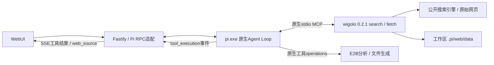

# Pi 原生联网接入

日期：2026-10-22。本阶段接入 Web Search / Web Fetch，保留 Pi 原生规划、上下文、模型与工具调用。示例一的完整多机构统计分析不在本次完成声明中。

## 调用链与边界

`.pi/agent/mcp.json` 声明 web 服务；Pi 负责连接、发现工具、请求超时和工具结果反馈。只将 search / fetch 设置为 direct，其余工具 hidden。应用未实现搜索API、内容抓取器、MCP传输层或第二套Agent Loop。`scripts/checks/web.ts` 中的SDK仅用于独立诊断，不参与应用运行。

`scripts/mcp/wigolo.ts` 通过自己的文件位置定位工作区，设置环境后调用上游 `dist/server.js` 的 `startServer()`，保留stdio给Pi。使用固定版本0.2.1，因为这是上游内部入口，升级时需重新核对导出、参数和测试。避免调用wigolo自带agent/research流程，本项目的分析与代码执行仍由Pi规划。

## 配置与可移动性

| 文件/目录 | 用途 |
|---|---|
| .pi/agent/mcp.json | command=node，入口scripts/mcp/wigolo.ts，timeout=90秒 |
| .pi/web/config.json | core后端；关闭localLlm和reranker；获取10秒、搜索30秒预算 |
| .pi/web/data/wigolo.db | 搜索及正文缓存，不随提交分发 |
| .pi/web/data/browsers | Playwright浏览器资源 |
| .pi/web/data/models及fastembed子目录 | 模型缓存环境路径；wigolo可能另用data/fastembed |
| .pi/web/data/tmp | 下载和浏览器临时文件 |
| .pi/web/plugins | 项目插件位置，当前不分发插件 |

Pi cwd固定为`.pi/runtime/<sessionId>`，MCP cwd=`../../..`因而定位项目根目录。RPC环境把当前Node目录加入PATH，并将Pi临时文件放在该会话的tmp目录；不依赖用户全局安装node命令的偶然位置。移动整个项目后，入口按新位置重新计算绝对路径，不依赖开发者桌面或原题目录。

启动器移除继承环境中API_KEY/TOKEN/SECRET/PASSWORD等凭证变量和内部桥地址，覆盖已有wigolo/Playwright缓存变量。应用模型/E2B凭据仍只供相应进程使用；不能将这种环境过滤当成完整的宿主机权限隔离。

wigolo不需要额外搜索Key，core后端无需SearXNG/Docker/Python。`pnpm install --frozen-lockfile`后运行`pnpm setup:web`。SQLite原生依赖若未安装成功，脚本从WiseLibs/better-sqlite3官方GitHub release选取当前版本、Node ABI、系统和架构的预编译包，存在摘要时核对SHA256，并检查归档路径后在工作区内解压。无匹配包会明确失败，不要求默默使用开发者全局库。

静态搜索和HTTP正文获取不要求安装浏览器。`pnpm setup:web --browser`可安装并检查Chromium；首轮下载较大，本机下载因速度慢未完成，未验证wigolo的JS渲染路径。需要渲染时上游也可能尝试后台安装，失败会通过工具反馈。上游抓取后的异步向量索引可能下载约30MB嵌入模型；本项目不依赖其成功，相关缓存仍在工作区。首次运行仍需要网络，不能承诺免安装、离线或免模型/E2B凭据。

## 来源记录与可信度

Pi自行决定搜索词、筛选官方来源、获取正文以及是否换源重试。环境提示要求先search再fetch、摘要仅供发现、优先官方机构、区分年份与统计口径。来源冲突时应展示各来源和差异，证据不足时明确限制；这是模型行为约束，尚未实现通用事实核验器或自动裁决器。

后端只从真实`mcp__web__fetch`完成事件提取来源。结果必须不是错误、有非空markdown、不是HTTP4xx/5xx，并有合法HTTP(S)地址；搜索摘要不生成正文来源卡片。记录URL、标题、域名、服务接收结果时间、缓存标记、字符数、可用的HTTP状态和内容哈希。该时间是本次工具结果返回时间，不等于网页发布时间或缓存首次抓取时间。

来源通过`web_source` SSE事件显示在对话面板，链接使用textContent、noopener/noreferrer。右侧保留原始工具参数和结果，标记`Pi MCP / wigolo`。模型结论仍显示`Pi 模型`。来源卡片说明实际获取与缓存，不能把可点击的官方域名自动等同于所有结论可靠。

分析产物由Pi在E2B生成，sources.md记录实际URL、机构、年份和访问时间。初次样本只记访问日期，曾将受长度限制的正文称为完整内容；后续又复现将cached_at误标为本次访问时间，仅补充提示不够。相关样本保留在history/web-initial和history/web-before-access-time。

现在通过Pi原生tool_result钩子为成功Fetch正文添加app_accessed_at（应用实际UTC时钟）及含义说明，保留上游cached_at与原始内容。模型据此写来源文件，前端另记服务接收工具结果时间。真实W01除调用和下载断言外，还核对存在该字段、产物时间落在本轮执行范围，避免旧缓存时间被当作访问时间；通过不代表任意引用或陈述都可靠。

## 异常与权限

无结果、限流、访问失败、验证码和异常正文由工具返回给Pi判断、调整搜索或说明失败；应用不提供虚构摘要作降级。失败的fetch不生成成功来源事件。返回了正常HTTP状态却是验证码页时仍需模型审查正文，当前提取器没有通用语义检测。

环境明确设置WIGOLO_FETCH_ALLOW_PRIVATE=false，上游拒绝私有LAN IPv4和元数据目标；真实192.168.0.1测试核对的是工具返回的private IPv4策略错误。wigolo 0.2.1仍允许localhost和127/8访问，false不能关闭这个例外。早期127.0.0.1测试只得到ECONNREFUSED，弱断言曾误记为策略拒绝；修正前证据保留在history/web-before-rejection-check，不能作为私网隔离证明。

wigolo作为可信宿主进程仍拥有操作系统权限；公开网页是低信任数据。其URL策略不是完整的宿主机网络隔离，未验证DNS重绑定等专项。数据处理和用户生成代码继续使用E2B。这里的目标是本机面试演示，不将此配置表述为公网多租户安全方案。

## 实际验证与剩余范围

- 类型检查通过，81项确定性测试通过，其中9项新增覆盖配置迁移、凭证过滤、真实结果格式、错误/恶意链接以及Pi事件适配。回放不是联网测试。
- `smoke:web`：真实stdio MCP发现、真实搜索、Fastify官方正文约1.2万字符、内网拒绝均通过；诊断不调用模型。
- `test:web`：真实模型/Pi原生MCP/E2B/HTTP/SSE共3/3通过：官方搜索和正文及来源文件、同会话Python统计来源文件、私有LAN地址实际策略拒绝并解释失败。
- `test:web:ui`：真实Edge+模型Fetch请求，来源卡片、精确链接、缓存与访问时间展示、执行器、零JS异常均通过。

证据在`docs/evidence/current/web/`，与此前10个Coding任务及9/10回答质量结果分别统计。搜索曾返回不相关旧版页面且内容获取失败，Pi随后获取官网并沿正文链接找到目标文档；保留原始Trace，不将每次调用都记为优质结果。

尚未执行：完整示例一、多机构年份对齐、真实互相矛盾来源、真实无结果/验证码专项、wigolo动态渲染、独立新机器冷启动和重复可靠性统计。
